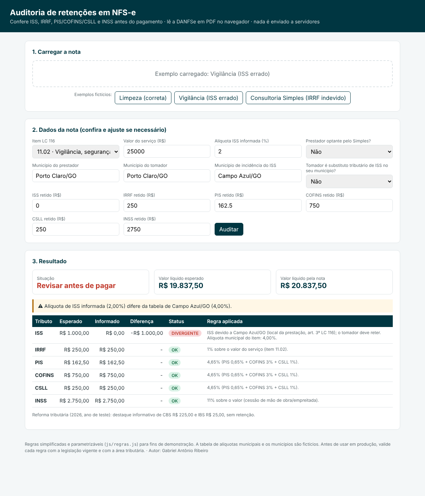

# Auditoria de retenções em NFS-e

  

App web que lê a **DANFSe em PDF no próprio navegador** e confere, **antes do pagamento**, se as retenções da nota de serviço estão corretas: **ISS** (inclusive a alíquota municipal), **IRRF**, **PIS/COFINS/CSLL** e **INSS**. Ao final, mostra o valor líquido que deveria ser pago.

> Notas, empresas, CNPJs, municípios e a tabela de alíquotas são **fictícios**. As regras são **simplificadas** para demonstração (veja o aviso abaixo).



## O problema

No contas a pagar, erros de retenção (alíquota de ISS errada, retenção indevida de prestador do Simples, ISS devido em outro município) só apareciam **no mês seguinte**, na apuração. Aí já era preciso cobrar o fornecedor ou recolher a diferença. A ideia é pegar o erro **na entrada da nota**.

## Como funciona

1. **Leitura do PDF** com `pdf.js`, sem servidor: o arquivo não sai do computador.
2. **Parser com escopo por seção** (`js/parser.js`). Os rótulos `CNPJ` e `Município` aparecem tanto no prestador quanto no tomador, e uma busca global sempre pegaria o primeiro. O texto é dividido em seções (prestador, tomador, serviço, valores) e cada campo é procurado **somente** na seção certa.
3. **Motor de regras** parametrizável (`js/regras.js`):

| Tributo | Regra implementada |
|---|---|
| IRRF | 1% (limpeza, vigilância…) ou 1,5% (serviços profissionais) por item; **Simples Nacional não sofre retenção**; dispensa até R$ 10,00 |
| PIS/COFINS/CSLL | 4,65% para os serviços da lista; Simples não sofre retenção; dispensa até R$ 10,00 |
| INSS | 11% em cessão de mão de obra/empreitada; no Simples, só para atividades do **Anexo IV** |
| ISS | devido no **local da prestação** para as exceções do art. 3º da LC 116 (ex.: 7.10, 11.02) → o tomador retém; alíquota conferida contra a **tabela do município** e o intervalo de 2% a 5% |
| Reforma tributária | destaque informativo de CBS (0,9%) e IBS (0,1%) no ano de teste de 2026 |

4. **Resultado**: esperado × informado por tributo, a regra aplicada em linguagem simples e o valor líquido esperado.

## Exemplos incluídos

| Nota fictícia | O que o app encontra |
|---|---|
| `01_limpeza_correta.pdf` | tudo conforme |
| `02_vigilancia_aliquota_errada.pdf` | ISS devido em outro município **não retido** e alíquota de 2% contra 4% da tabela |
| `03_consultoria_simples_nacional.pdf` | IRRF de R$ 72,00 retido **indevidamente** de prestador do Simples |

## Executar e testar

```bash
python -m http.server 8000      # abra http://localhost:8000 (módulos ES exigem servidor)
npm install && npm test         # 6 testes: parser nos PDFs + regras
python scripts/gerar_exemplos.py   # regenera as DANFSe fictícias (reportlab)
```

Funciona no **GitHub Pages**: *Settings › Pages › Deploy from branch (main, /root)*.

## Aviso

As regras foram **simplificadas** e não cobrem todas as hipóteses legais: legislação municipal específica, deduções de base, materiais na empreitada, isenções etc. Os percentuais e listas ficam centralizados em `js/regras.js` para facilitar a revisão. Em uso real, valide com a legislação vigente e com a área tributária.

## Stack

JavaScript (ES modules) · pdf.js · HTML/CSS · node:test · Python/reportlab (geração das notas fictícias)

---
Autor: **Gabriel Antônio Ribeiro**, Analista Financeiro · [LinkedIn](https://www.linkedin.com/in/gabriel-ant%C3%B4nio-ribeiro-017808210)
